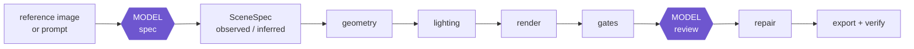

<div align="center">

# King3D.AI

**Reference image or prompt in — verified, game-ready 3D asset out.**

Procedural generation in Blender, checked before it's handed over — not a diffusion model, not a black box.

[](https://nodejs.org)
[](tsconfig.json)
[](https://www.blender.org)
[](docs/mcp-server.md)
[](#testing)
[](#how-it-works)

[Quick start](#quick-start) · [How it works](#how-it-works) · [Three ways to drive it](#three-ways-to-drive-it) · [Docs](#documentation) · [Design notes](#design-notes-worth-knowing)

</div>

---

Informed by [img2threejs](https://github.com/img2threejs/img2threejs) (staged
generation behind quality gates, model tokens spent only on visual judgement) and
[blender-mcp](https://github.com/ahujasid/blender-mcp) (driving Blender from an
agent) — architecturally related to both, copying neither.

## Status

The pipeline runs end to end: reference image in, verified GLB out.

| Capability | Entry point | Docs |
|---|---|---|
| **Blender bridge** — 24 typed commands, two transports, one shared Python implementation | — | [`docs/blender-bridge.md`](docs/blender-bridge.md) |
| **SceneSpec** — the source of truth, every field marked `observed` or `inferred` | — | [`docs/pipeline.md`](docs/pipeline.md) |
| **Analysis** — reference image → spec draft | `king3d gen --image` | |
| **Deterministic build** — geometry, lighting, renders, 11 quality gates, GLB export verified by re-import | `king3d build` | |
| **Review and repair** — similarity score plus defects, each optionally carrying a fix applied back to the spec | `king3d review --rebuild` | |
| **Viewer** — the exported GLB in a browser | `king3d viewer` | |
| **Dashboard** — a browser control panel over the whole loop: upload, spec, build (streamed live), report, model, review, repair, rebuild | `king3d web` | [`docs/dashboard.md`](docs/dashboard.md) |
| **MCP server** — the same pipeline as MCP tools, so any MCP-compatible coding agent (Claude Code, Claude Desktop, Cursor, Windsurf, …) can drive it directly | `node src/mcp/index.ts` | [`docs/mcp-server.md`](docs/mcp-server.md) |

**118 tests pass** — 97 under vitest, 21 inside Blender, including the code paths the dashboard and the MCP server both reuse from the CLI's own pipeline functions.

Not built yet: multi-view input, LOD generation, external 3D-generation providers.

## Quick start

```bash
npm install
node src/cli/index.ts doctor            # check the environment
node src/cli/index.ts fixtures:build    # render a synthetic reference to try it on
node src/cli/index.ts web               # open the dashboard at http://127.0.0.1:5180
```

`docs/setup.md` covers requirements and configuration in full. **No AI API key is
needed** — see [How it works](#how-it-works) for why.

## How it works



Only two stages need eyes — turning a reference into a spec, and judging a render
against it. Everything between them is arithmetic: geometry, lighting, rendering,
gate scoring, GLB export and re-import verification are all deterministic. That's
the point — **model tokens are spent on visual judgement, never on bookkeeping**,
and the same spec always reproduces the same scene.

The two judgement stages work by writing a self-contained question to disk and
waiting for a JSON answer — the coding agent already driving the session *is* the
model, whether that's through the CLI, the dashboard, or an MCP tool call. No API
key, no per-token cost, no secret to leak. `docs/pipeline.md` covers the stages,
the 11 gates, and the repair vocabulary in full.

## Three ways to drive it

<table>
<tr><td width="33%" valign="top">

### Dashboard
Browser control panel — upload, spec, build (live), report, 3D viewer, review, repair.

```bash
node src/cli/index.ts web
```
[`docs/dashboard.md`](docs/dashboard.md)

</td><td width="33%" valign="top">

### CLI
Scriptable, resumable, one command per stage.

```bash
node src/cli/index.ts gen \
  --image tests/fixtures/mug_reference.png \
  --run-id slice
# answer the spec request, re-run
node src/cli/index.ts review slice
node src/cli/index.ts viewer slice
```

</td><td width="33%" valign="top">

### MCP server
Any MCP-compatible coding agent drives it directly, tool by tool.

```bash
claude mcp add king3d -- \
  node src/mcp/index.ts
```
[`docs/mcp-server.md`](docs/mcp-server.md)

</td></tr>
</table>

## Design notes worth knowing

* **The daemon is the point.** Starting Blender costs 30–90s on modest hardware
  while a command batch costs milliseconds, so one Blender is kept alive and fed
  batches over a socket. Measurements are in [`docs/blender-bridge.md`](docs/blender-bridge.md).
* **Nothing is assumed to have worked.** The exporter is not trusted (the GLB is
  re-imported and compared), the renderer is not trusted (the file must exist),
  and both sides of every wire validate against the same schemas.
* **The spec, not the scene, is edited.** A repair changes the SceneSpec and
  rebuilds, which keeps every result reproducible from a single JSON file.
* **One pipeline, three front ends.** The CLI, the dashboard, and the MCP server
  all call the exact same functions in `src/pipeline/` and `src/server/routes.ts`
  — a run created from any of them is indistinguishable on disk.

## Testing

```bash
npm test            # vitest — protocol, spec validation, gates, routes, MCP server
npm run test:blender # unit tests inside Blender's own interpreter
npm run typecheck
npm run bench        # measure this machine's Blender startup and render cost
```

## Layout

```
src/core/                 config, logging, error taxonomy
src/integrations/blender/ the bridge: protocol, framing, backends, daemon
src/spec/                 SceneSpec and fixtures
src/pipeline/             builder, gates, review, run orchestration
src/providers/            model providers (agent-in-the-loop by default)
src/server/               dashboard: pure JSON routes + the node:http adapter
src/mcp/                  MCP server: same routes, exposed as tools over stdio
src/cli/                  the king3d command
web/                      dashboard frontend (vanilla HTML/JS, no build step)
blender/ai3dlib/          the Blender-side Python
blender/tests/            unit tests that run inside Blender
tests/                    vitest suites
docs/
```

## Documentation

| Doc | Covers |
|---|---|
| [`docs/setup.md`](docs/setup.md) | Requirements, installation, configuration |
| [`docs/pipeline.md`](docs/pipeline.md) | The 8 stages, gates, provenance, the repair vocabulary |
| [`docs/blender-bridge.md`](docs/blender-bridge.md) | The daemon, the wire protocol, measured performance |
| [`docs/dashboard.md`](docs/dashboard.md) | The web control panel, its API, and its architecture |
| [`docs/mcp-server.md`](docs/mcp-server.md) | The MCP tools, how to register them, a worked session |
